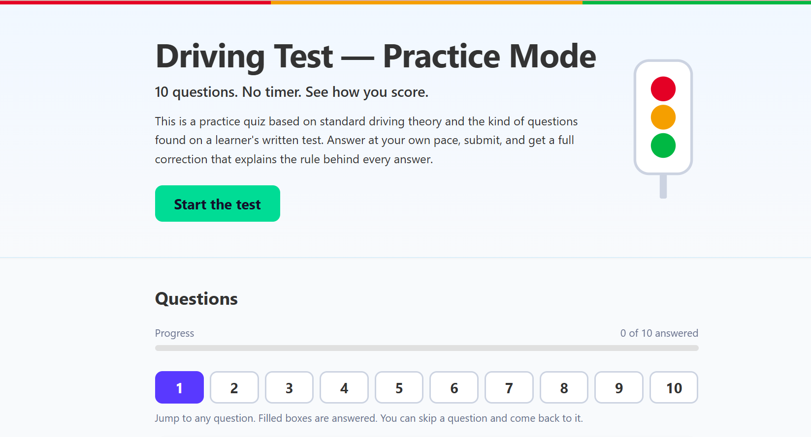

# Driving Test — Practice Mode

A self-contained, 10-question driving theory practice quiz with instant grading and a full correction page — plain HTML, CSS and JavaScript.

## Screenshot



Drop your own screenshot named `screenshot.png` next to this README and it will appear here.

## Features

- Hero banner with a smooth-scrolling "Start the test" button and a decorative inline-SVG traffic light.
- One question at a time in a central panel — no timer, no time pressure.
- A numbered navigator lets you jump to any question; filled boxes are answered.
- **Previous** and **Next** buttons; the Next button reads **Skip question** when the current one is unanswered, so you can move on and return later.
- Choosing an answer with a mouse or touch moves on to the next question automatically (keyboard users stay put and press Next).
- Each question is a `<fieldset>` with a `<legend>` and exactly four radio options.
- Live progress bar showing how many questions are answered.
- Validation on submit that lists the unanswered questions, marks them in the navigator and opens the first one.
- Results page with a percentage, a colour-coded grade band, and a full correction for every question.
- Retake (clears the saved attempt) and Print / Save as PDF with a clean print stylesheet.
- Automatic dark mode, responsive layout, keyboard-friendly, honours reduced-motion settings.
- Works offline from `file://` or any static server. No dependencies, no network requests.

## File structure

```text
driving-test/
├── index.html        # Intro, quiz form (navigator + controls) and footer; questions are rendered by JS
├── results.html      # Grade card and corrections; redirects if there is no attempt
├── css/
│   └── style.css     # All styling; every colour is a token on :root
├── js/
│   ├── questions.js  # The question bank (edit this to change questions)
│   ├── quiz.js       # Renders questions, validates, scores, saves the attempt
│   └── results.js    # Reads the attempt and renders the results
└── README.md         # This file
```

## How to run

**Option A — double-click.** Open `index.html` in your browser. It works directly from `file://`.

**Option B — local server.**

```bash
python3 -m http.server 8000
```

Then open <http://localhost:8000>.

## How it works

1. `index.html` loads `js/questions.js` and `js/quiz.js`. The script builds one fieldset per question from the `QUESTIONS` array and shows one at a time; the navigator, Previous/Next buttons and progress bar stay in sync with your answers.
2. On submit, `quiz.js` checks every question has an answer. If not, it shows "Please answer questions 3, 7, and 9." in an `aria-live="polite"` box, highlights those numbers in the navigator and opens the first unanswered question.
3. When complete, it scores the attempt and saves it, then opens `results.html`.
4. `results.html` reads the attempt. If none exists it immediately redirects to `index.html`. Refreshing the page keeps the results; only **Retake the test** clears them.

**localStorage contract**

- Key: `driving-test-result`
- Value: a JSON string of

```js
{ score: number, total: number, answers: number[], timestamp: number, questions: object[] }
```

- `answers` holds the chosen option index (0–3) for each question, in order.
- `questions` is a full copy of the question objects at the time of the attempt, so the results stay correct even if the bank is edited later.

**File-protocol fallback.** Some browsers isolate `localStorage` between separate `file://` pages. To keep the "open index.html directly" promise, the attempt is also copied into `window.name` (same tab only). The results page reads `localStorage` first and uses this copy only if the key is missing. **Retake** clears both.

## Adding or editing questions

1. Open `js/questions.js`.
2. Edit an existing object, or copy one. Keep the exact shape:
   ```js
   {
     id: 11,
     question: "…",
     options: ["…", "…", "…", "…"],
     correctIndex: 2,
     explanation: "…"
   }
   ```
3. Keep exactly four options and set `correctIndex` to 0, 1, 2 or 3 (the position of the right option).
4. Give every question a unique `id` (it becomes the radio group name, e.g. `q11`).
5. Write an explanation that teaches the rule, not just the answer.
6. Save and reload. No build step. The navigator, progress bar and scoring adapt to the number of questions (the navigator grid is laid out for 10, so very different counts may need a small CSS tweak).

## Design notes

Clean and modern, with soft shadows, 8–12px radii and generous spacing. The type is the system font stack (`system-ui, -apple-system, "Segoe UI", Roboto, sans-serif`) so it loads instantly, looks native on every device and needs no font files; a monospace stack is defined for code-like text.

Every colour is a CSS custom property on `:root`, and dark mode and print only override those tokens.

| Token | Light value | Job |
| --- | --- | --- |
| `--color-primary` | `#007bff` | Main buttons, selected radio, progress |
| `--color-primary-surface` | `#e6f0ff` | Primary-outline hover, selected option |
| `--color-secondary` | `#20c997` | "Start the test", "Good" band (fill only) |
| `--color-secondary-surface` | `#e0fff6` | Secondary-outline hover |
| `--color-banner` | `#f0f8ff` | Hero surface |
| `--color-banner-border` | `#cceeff` | Hero border |
| `--color-bg` | `#f8fafc` | Page background |
| `--color-card` | `#ffffff` | Card surface |
| `--color-text` | `#333333` | Body text |
| `--color-muted` | `#64748b` | Hints, helper text, footer |
| `--color-divider` | `#f1f5f9` | Hairlines |
| `--color-track` | `#e0e0e0` | Progress-bar track |
| `--shadow-soft` | `rgba(0,0,0,0.05)` | Banner and strips |
| `--shadow-card` | `rgba(0,0,0,0.1)` | Cards |
| `--color-disabled` | `#9ca3af` | Disabled buttons |
| `--color-correct` | `#15803d` | Correct answers |
| `--color-incorrect` | `#b91c1c` | Wrong answers, errors |
| `--grade-excellent` | `#15803d` | 90–100% |
| `--grade-good` | `#20c997` | 70–89% |
| `--grade-fair` | `#d97706` | 50–69% |
| `--grade-poor` | `#b91c1c` | Below 50% |
| `--signal-red` / `--signal-amber` / `--signal-green` | `#dc2626` / `#f59e0b` / `#16a34a` | Decorative only |

Supporting tokens added for the build: `--color-border` (option outlines), `--color-focus`, `--color-on-primary`, `--color-on-secondary`, `--color-on-grade` (text on filled surfaces), `--color-incorrect-surface` (error box tint).

Dark mode (`prefers-color-scheme: dark`): background `#0f172a`, card `#1e293b`, text `#e2e8f0`, muted `#94a3b8`, divider `#334155`, primary `#60a5fa`, secondary `#2dd4bf`, focus ring `#60a5fa`. Semantic and grade colours are lightened so they stay readable on dark cards.

Contrast choices: `#20c997` is never used as text on a light background; it is a fill with dark text on top. Primary buttons use large bold text so `#007bff` meets the AA large-text ratio.

## Accessibility

- Every radio has a `<label for>` tied to its `id`; every question is a `<fieldset>` with a `<legend>`.
- The error box uses `aria-live="polite"`; the progress bar uses `role="progressbar"`.
- Visible `:focus-visible` outlines everywhere, including on custom radio options and navigator buttons.
- The navigator buttons carry labels such as "Question 3, answered", and the current one has `aria-current="step"`. Focus moves to the new question when you navigate, so screen readers announce it.
- Auto-advance only happens for mouse/touch answers, never when moving through options with the arrow keys.
- A skip link, a logical heading order and the whole flow work by keyboard (Tab, Space/arrow keys, Enter).
- Correct/incorrect is never colour-only: ✓ / ✗ marks plus screen-reader text.
- `prefers-reduced-motion: reduce` disables animation and smooth scrolling.

To verify: tab through the page with the keyboard only, run a Lighthouse accessibility audit in Chrome DevTools, and try a screen reader or the browser's forced-colours and dark modes.

## Built with

Plain HTML, CSS and JavaScript. No frameworks, build tools or external assets.

## Disclaimer

This is a practice tool. It is not affiliated with any licensing authority. For the official test, refer to the driving handbook issued by your local authority.

## Author

Clément Sampebgo
